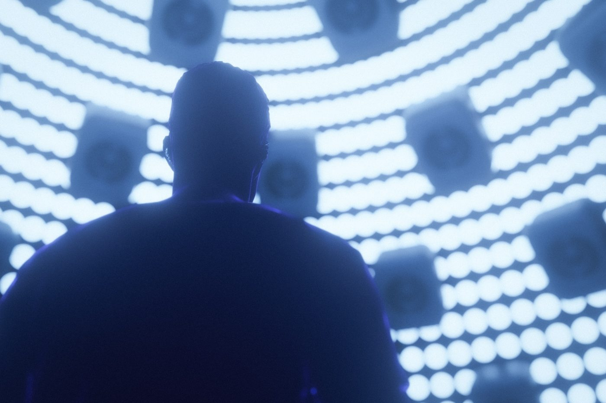

The Special Interest Group in Spatial Acoustics and Immersive Audio (SIG-SAIA) brings together researchers, practitioners and end-users from academia and industry who work on the spatial side of audio and acoustics.

SIG-SAIA started as a special interest group within the [UK Acoustics Network (UKAN)](https://acoustics.ac.uk/) and now runs as an independent group.

## Join the mailing list

The SIG-SAIA mailing list is a Google Group. Members receive announcements about meet-ups, seminars, workshops, jobs and calls for papers, and can post to the list.

- **With a Google account:** go to [groups.google.com/g/sig-saia](https://groups.google.com/g/sig-saia) and click **Join group**.
- **Without a Google account:** send a blank email to [sig-saia+subscribe@googlegroups.com](mailto:sig-saia+subscribe@googlegroups.com) from the address you want to use, then reply to the confirmation email.

To leave, send a blank email to [sig-saia+unsubscribe@googlegroups.com](mailto:sig-saia+unsubscribe@googlegroups.com) or use the link at the bottom of any list email.

## What we cover

- **Acquisition:** microphone arrays, beamforming, direction-of-arrival estimation and 6DoF sound field capture.
- **Rendering:** loudspeaker arrays, headphone and binaural rendering, and acoustic augmented reality.
- **Perception:** spatial hearing, listening experiments and binaural auditory models.
- **Applications:** immersive audio production, AR/VR for audiology research and clinical use, auditory training and auditory displays.

## What we do

We run topic-focused meet-ups for members, a yearly workshop or showcase, and a seminar series. We also organise joint events with groups such as Immerse UK, the AES, the IEEE and the Institute of Acoustics, along with training events aimed at early-career researchers.

## Coordinators

- Prof Lorenzo Picinali, Imperial College London
- Dr Aidan Hogg, Queen Mary University of London
- Prof Filippo Fazi, University of Southampton (ISVR)
- Dr Jacob Hollebon, Audioscenic

Past meet-ups

## Our in-person meet-ups combine short talks from members with visits to labs, venues and industry partners.

 
  
 
 <h3 class="mt-0" style="font-size: 1.15rem;">Queen Mary University of London and Yamaha Music London</h3> 
24 November 2026
 
Eight short talks on topics from auraldiversity and personalised HRTFs to loudspeaker layouts, room acoustics and immersive audio authoring, followed by a Sound xR session at Yamaha Music London hosted by Tom Rundle.
 
<a href="https://acoustics.ac.uk/fifth-in-person-sig-saia-meet-up/">Programme</a>
 
 
 
 
  
 
 <h3 class="mt-0" style="font-size: 1.15rem;">KEF Music Gallery, London</h3> 
20 February 2025
 
A tour of the KEF Music Gallery and listening sessions in its demo rooms, with the KEF team sharing their loudspeaker design expertise.
 
<a href="https://acoustics.ac.uk/third-in-person-sig-saia-meet-up/">Programme</a>
 
 
 
 
  
 
 <h3 class="mt-0" style="font-size: 1.15rem;">Queen Mary University of London and the Royal Opera House</h3> 
10 May 2024
 
Talks on HRTF time-of-arrival estimation, perceptual tolerances in room acoustic rendering for VR and AR, choir source separation, ecological validity in spatial sound research and immersive audio challenges, followed by a backstage tour of the Royal Opera House.
 
<a href="https://acoustics.ac.uk/second-in-person-sig-saia-meet-up/">Programme</a>
 
 
 
 
  
 
 <h3 class="mt-0" style="font-size: 1.15rem;">Imperial College London</h3> 
21 April 2023
 
Presentations from attendees, a tour of Imperial's acoustics lab and a talk from the Sonos London team.
 
<a href="https://acoustics.ac.uk/first-in-person-sig-saia-meet-up/">Programme</a>
 
 
 
 
  
 
 <h3 class="mt-0" style="font-size: 1.15rem;">L-Acoustics Showroom, Highgate, London</h3> 
20 June 2022
 
Our first meet-up: a listening session in the L-Acoustics Sound Space and its 18.1.12 loudspeaker system, with demos from the L-Acoustics team, a playback of pieces from the Student 3D Audio Production Competition in Ambisonics run by IEM Graz and the VDT, and a demo of creation tools.
 
<a href="https://aidanhogg.uk/visit-to-l-acoustics-ukan-saia/">Write-up</a>
 
 

