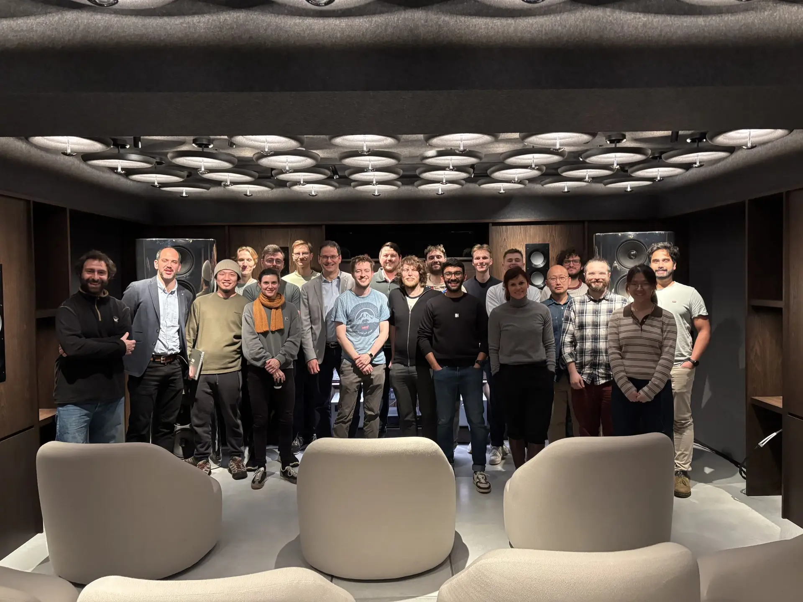
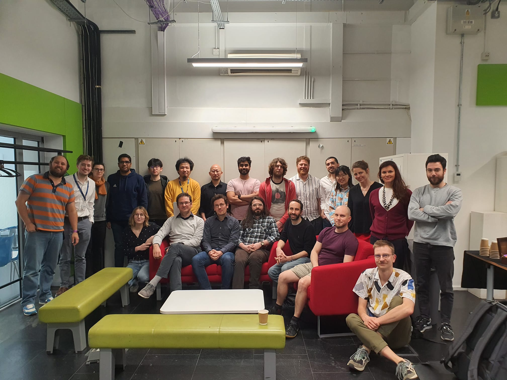
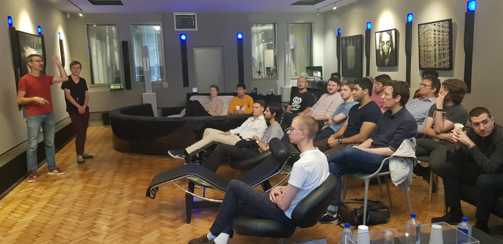

The Special Interest Group in Spatial Acoustics and Immersive Audio (SIG-SAIA) brings together researchers, practitioners and end-users from academia and industry who work on the spatial side of audio and acoustics.

SIG-SAIA started as a special interest group within the [UK Acoustics Network (UKAN)](https://acoustics.ac.uk/) and now runs as an independent group.

## Join the mailing list

The SIG-SAIA mailing list is a Google Group. Members receive announcements about meet-ups, seminars, workshops, jobs and calls for papers, and can post to the list.

- **With a Google account:** go to [groups.google.com/g/sig-saia](https://groups.google.com/g/sig-saia) and click **Join group**.
- **Without a Google account:** send a blank email to [sig-saia+subscribe@googlegroups.com](mailto:sig-saia+subscribe@googlegroups.com) from the address you want to use, then reply to the confirmation email.

To leave, send a blank email to [sig-saia+unsubscribe@googlegroups.com](mailto:sig-saia+unsubscribe@googlegroups.com) or use the link at the bottom of any list email.

## What we cover

- **Acquisition:** microphone arrays, beamforming, direction-of-arrival estimation and 6DoF sound field capture.
- **Rendering:** loudspeaker arrays, headphone and binaural rendering, and acoustic augmented reality.
- **Perception:** spatial hearing, listening experiments and binaural auditory models.
- **Applications:** immersive audio production, AR/VR for audiology research and clinical use, auditory training and auditory displays.

## What we do

We run topic-focused meet-ups for members, a yearly workshop or showcase, and a seminar series. We also organise joint events with groups such as Immerse UK, the AES, the IEEE and the Institute of Acoustics, along with training events aimed at early-career researchers.

## Coordinators

- Prof Lorenzo Picinali, Imperial College London
- Dr Aidan Hogg, Queen Mary University of London
- Prof Filippo Fazi, University of Southampton (ISVR)
- Dr Jacob Hollebon, Audioscenic

## Past meet-ups

Our in-person meet-ups combine short member talks with visits to labs, venues, and industry partners.

 
  
 
 <h3 class="mt-0" style="font-size: 1.15rem;">Queen Mary University of London and Yamaha Music London</h3> 
24 November 2026
 
Eight short talks on topics from auraldiversity and personalised HRTFs to loudspeaker layouts, room acoustics and immersive audio authoring, followed by a Sound xR session at Yamaha Music London hosted by Tom Rundle.
 
 
Programme
 <ul class="mt-2 mb-0" style="font-size: 0.9rem;"> <li class="mt-2" style="list-style: none; margin-left: -1rem;"><strong>At Queen Mary (10-minute talks, including questions)</strong></li> <li><strong>11:45–12:30</strong> Arrival and lunch</li> <li><strong>12:30–12:35</strong> Welcome and introduction, Aidan Hogg (Queen Mary University of London)</li> <li><strong>12:35–12:45</strong> John Levack Drever (Cambridge Digital Humanities, University of Cambridge), <em>Whose Spatial Hearing? Auraldiversity and the Limits of Immersive Audio</em></li> <li><strong>12:45–12:55</strong> Rashad Al-Dahiri (Queen Mary University of London), <em>Individualised Head-Related Transfer Function Generation via Geometric Parameterisation of Synthetic Pinnae</em></li> <li><strong>12:55–13:05</strong> Philip Jackson (University of Surrey), <em>Design of the Aurora3 loudspeaker arrangement</em></li> <li><strong>13:05–13:15</strong> Rapolas Daugintis (University of Surrey), <em>Perceptually-driven optimisation of loudspeaker-based spatial audio</em></li> <li><strong>13:15–13:25</strong> Nara Hahn (University of Southampton), <em>Sound field diffuseness estimation in the spherical harmonic domain</em></li> <li><strong>13:25–13:35</strong> Orchisama Das (King’s College London), <em>Physics-Inspired Delay Networks for Auralisation of Room Acoustics</em></li> <li><strong>13:35–13:45</strong> Yuke Liu (Queen Mary University of London), <em>A Benchmark of World Models’ Capabilities from Spatial Audio Perspective: A Preliminary Design</em></li> <li><strong>13:45–13:55</strong> Daniel Jones (Independent), <em>Authoring immersive audio environments with Hodr and SignalFlow</em></li> <li><strong>13:55–14:00</strong> Discussion of future plans for the group, Lorenzo Picinali (Imperial College London)</li> <li><strong>14:00–14:15</strong> Group photo and wrap-up</li> <li class="mt-2" style="list-style: none; margin-left: -1rem;"><strong>At Yamaha Music London</strong></li> <li><strong>15:00–16:30</strong> Sound xR session hosted by Tom Rundle: an introduction to the Yamaha product range, two guest speakers on how they use Sound xR in their work, and a demonstration with questions and discussion</li> </ul> 
 
 
 
 
  
 
 <h3 class="mt-0" style="font-size: 1.15rem;">KEF Music Gallery, London</h3> 
20 February 2025
 
A tour of the KEF Music Gallery and listening sessions in its demo rooms, with the KEF team sharing their loudspeaker design expertise.
 
 
Programme
 <ul class="mt-2 mb-0" style="font-size: 0.9rem;"> <li><strong>10:00–10:15</strong> Tea and coffee</li> <li><strong>10:15–10:30</strong> Welcome and participant introductions</li> <li><strong>10:30–11:30</strong> KEF Music Gallery tour</li> <li><strong>11:30–12:30</strong> Listening sessions in the Living Room and UER</li> <li><strong>12:30–13:30</strong> Lunch</li> <li><strong>13:30–15:30</strong> Group activities</li> <li><strong>15:30–16:00</strong> Wrap-up and Q&amp;A</li> </ul> 
 
 
 
 
  
 
 <h3 class="mt-0" style="font-size: 1.15rem;">Queen Mary University of London and the Royal Opera House</h3> 
10 May 2024
 
Talks on HRTF time-of-arrival estimation, perceptual tolerances in room acoustic rendering for VR and AR, choir source separation, ecological validity in spatial sound research and immersive audio challenges, followed by a backstage tour of the Royal Opera House.
 
 
Programme
 <ul class="mt-2 mb-0" style="font-size: 0.9rem;"> <li class="mt-2" style="list-style: none; margin-left: -1rem;"><strong>At Queen Mary, Mile End (15-minute talks plus 5 minutes for questions)</strong></li> <li><strong>10:00–10:30</strong> Tea and coffee</li> <li><strong>10:30–10:40</strong> Participant introductions</li> <li><strong>10:40–11:00</strong> Chin-Yun Yu (Queen Mary University of London), <em>Time-of-arrival estimation and phase unwrapping of head-related transfer functions with integer linear programming</em></li> <li><strong>11:00–11:20</strong> Annika Neidhardt (University of Surrey), <em>Perceptual Tolerances in Room Acoustic Rendering for VR and AR</em></li> <li><strong>11:20–11:40</strong> Saurjya Sarkar (Queen Mary University of London), <em>Time-domain music source separation for choirs and ensembles</em></li> <li><strong>11:40–12:00</strong> Angela McArthur (UCL), <em>Ecological validity in spatial sound research – why?</em></li> <li><strong>12:00–12:20</strong> Lorenzo Picinali (Imperial College London), <em>Immersive Audio Challenges</em></li> <li><strong>12:20–13:00</strong> Lunch</li> <li class="mt-2" style="list-style: none; margin-left: -1rem;"><strong>At the Royal Opera House</strong></li> <li><strong>13:30–14:30</strong> Introduction and talk about the Royal Opera House, its broadcasts and the building</li> <li><strong>14:30–15:00</strong> Q&amp;A</li> <li><strong>15:00–16:00</strong> Backstage tour</li> </ul> 
 
 
 
 
  
 
 <h3 class="mt-0" style="font-size: 1.15rem;">Imperial College London</h3> 
21 April 2023
 
Presentations from attendees, a tour of Imperial’s acoustics lab and a talk from the Sonos London team.
 
 
Programme
 <ul class="mt-2 mb-0" style="font-size: 0.9rem;"> <li><strong>13:30–14:00</strong> Tea and coffee</li> <li><strong>14:00–14:15</strong> Participant introductions</li> <li><strong>14:15–15:30</strong> Presentations from attendees</li> <li><strong>15:30–16:00</strong> Tour of the Imperial acoustics lab</li> <li><strong>16:00–17:15</strong> Talk from the Sonos London team on their work and interests</li> <li><strong>17:15–17:30</strong> Discussion on taking the group’s activities forward</li> </ul> 
 
 
 
 
  
 
 <h3 class="mt-0" style="font-size: 1.15rem;">L-Acoustics Showroom, Highgate, London</h3> 
20 June 2022
 
Our first meet-up: a listening session in the L-Acoustics Sound Space and its 18.1.12 loudspeaker system, with demos from the L-Acoustics team, a playback of pieces from the Student 3D Audio Production Competition in Ambisonics run by IEM Graz and the VDT, and a demo of creation tools.
 
 
Programme
 <ul class="mt-2 mb-0" style="font-size: 0.9rem;"> <li><strong>16:20–17:00</strong> L-Acoustics demos</li> <li><strong>17:00–17:10</strong> Break</li> <li><strong>17:15–18:00</strong> 3D sound compositions: a selection of pieces from the Student 3D Audio Production Competition in Ambisonics, organised each year by the Institute of Electronic Music and Acoustics (IEM) in Graz with the German Association for Audio Professionals (VDT)</li> <li><strong>18:00–18:30</strong> Creation tools demo</li> </ul> 
 
 

